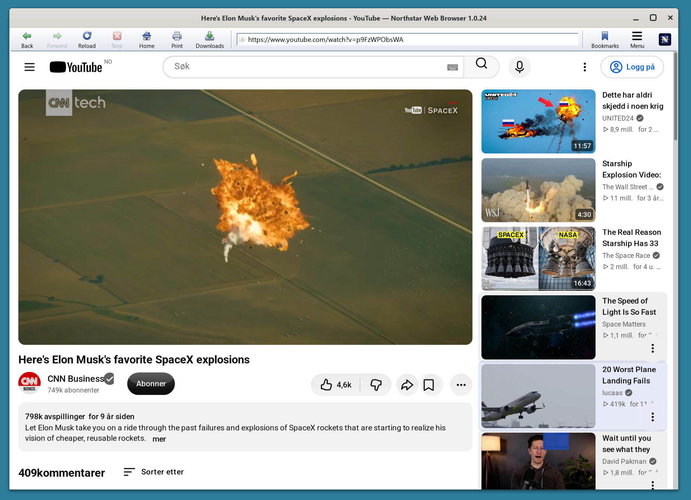

# Northstar Web Browser

[](LICENSE)
[](https://github.com/nordstjernen-web/northstar-web-browser/releases/latest)
[](https://nordstjernen.org)

Northstar Web Browser is a minimalist web browser written in C, started in 2026. Its
engine targets practical HTML5, modern CSS and JavaScript compatibility
without embedding Gecko, WebKit, Blink or another browser engine. Linux
is the primary platform; macOS, Windows and the BSDs are also supported.



Repository: <https://github.com/nordstjernen-web/northstar-web-browser>.  
Windows store: https://apps.microsoft.com/detail/9p39zb79jv0t  

**See [Nordstjernen Sol](https://github.com/nordstjernen-web/nordstjernen-sol-browser) also, which is
the most complete, fully featured web browser project we are making. Nordstjernen Sol has ready-made builds for Windows, macOS, Linux and Android.**

Northstar Web Browser is licensed under the GNU General Public License, version 3 or
later.

## Multiple browser variants
* This repo, [Northstar Web Browser](https://github.com/nordstjernen-web/northstar-web-browser), is a minimalist, simple and good web browser: one process, one page per window, GPL only. It is more about research into browser technology.
* [Nordstjernen Sol](https://github.com/nordstjernen-web/nordstjernen-sol-browser) is the Nordstjernen web browser, the most complete, fully featured web browser, with tabs in sandboxed renderer processes and builds for desktop and Android.
* [Southstar](https://github.com/nordstjernen-web/southstar-browser) is Nordstjernen Sol rewritten in Rust, with the Boa JavaScript engine.

We are doing web browser innovation, research and development, and part of this is
making multiple web browser variants to test and compare.

**Downloads** of the three browser variants:

| Browser | All releases | Latest release |
|---------|--------------|----------------|
| [Nordstjernen Sol Browser](https://github.com/nordstjernen-web/nordstjernen-sol-browser) | [](https://github.com/nordstjernen-web/nordstjernen-sol-browser/releases) | [](https://github.com/nordstjernen-web/nordstjernen-sol-browser/releases/latest) |
| [Southstar Browser](https://github.com/nordstjernen-web/southstar-browser) | [](https://github.com/nordstjernen-web/southstar-browser/releases) | [](https://github.com/nordstjernen-web/southstar-browser/releases/latest) |
| [Northstar Web Browser](https://github.com/nordstjernen-web/northstar-web-browser) | [](https://github.com/nordstjernen-web/northstar-web-browser/releases) | [](https://github.com/nordstjernen-web/northstar-web-browser/releases/latest) |


**Web standards:** Behaviour is measured against the specification text,
section by section, not against another browser. The engine runs
web-platform-tests through headless mode; see
[docs/compliance.md](docs/compliance.md) for the current per-area scores
and the known structural gaps.

**Security:** on Linux the browser runs behind a Landlock filesystem
sandbox (plus `PR_SET_NO_NEW_PRIVS`) and a default-deny seccomp syscall
filter, which also refuses executable memory, new namespaces and signals
to other processes, in both GUI and headless/tooling modes. On macOS a
sandbox profile confines writes, and on Windows the process runs with
mitigation policies. There is no JIT. Frames, workers and extensions are
held to their own origin and Content-Security-Policy. See
[docs/security-model.md](docs/security-model.md) for the exact per-mode posture and the known
gaps.

**Minimalism:** one page per window, one browser process. The GTK shell
runs on the main thread and the page engine on one dedicated thread with
its own main loop, so a slow page never freezes the window; the shell posts
requests to that thread and gets rendered frames back, all inside the
same process. The engine is a compact body of C — about 234,000 lines of
original C, excluding the vendored web-text-lib, WAMR, Wuffs and audio
decoders — small enough for one person to read and audit end-to-end. See
[docs/architecture.md](docs/architecture.md) for how it fits together.

## What this edition is

This edition strips Nordstjernen down to a tab-less, single-process
desktop browser, based on the
[Nordstjernen project](https://github.com/nordstjernen-web/nordstjernen-sol-browser).
It deliberately omits tabs, per-tab renderer processes, WebGPU
and AI-style web APIs. WebGL 1 and 2 are supported through the system's
OpenGL driver, which runs inside the browser process; they can be turned
off in Settings (see [docs/webgl.md](docs/webgl.md)). PDFs open in a viewer built on Mozilla's PDF.js,
run as ordinary page script under a sandboxing policy that gives it an
opaque origin, so it cannot read the hosting site's cookies or storage. It does not send telemetry
or update pings; the only service it contacts on its own is Google Safe
Browsing, and only in a build made with a Safe Browsing API key (see
below). A build from source has no key, so it contacts no service on its
own.

Audio and video still play in-process (MP3, MP2, AAC, Ogg Opus/Vorbis;
MPEG-1, and AV1, VP9 and H.264 when their decoders are present — on Linux
through GStreamer by default, so YouTube streams with the system's
GStreamer plugins, and on Windows through the system's Media Foundation
codecs). Images
decode in-tree (PNG/APNG, GIF, BMP, JPEG and WebP via Wuffs, AVIF
through libavif when available, and SVG in the engine).

## Browser features

- **HTML** parsed to a DOM by lexbor, with `<dialog>` and popovers;
  **CSS** by the engine's own cascade — flex, grid and subgrid,
  transforms, gradients, `@keyframes`, scroll snap, container queries,
  cascade layers, `@scope`, `:has()`, nesting, `@property`, `oklch()`
  and `color-mix()` colours, and typed `calc()` math over lengths,
  angles, times and resolutions.
- **JavaScript** on the quickjs-ng interpreter (or Fabrice Bellard's
  original QuickJS) — DOM, Shadow DOM, Mutation/Intersection/Resize/
  Performance observers, `Intl`, Canvas 2D (`Path2D`, `ImageBitmap`,
  `DOMMatrix`, `OffscreenCanvas`), WebCrypto (`crypto.subtle` over
  OpenSSL).
- **Custom elements** — autonomous and customized built-in elements.
- **Workers** — dedicated workers with structured-clone messaging,
  message channels and broadcast channels.
- **Storage** — IndexedDB over SQLite, `localStorage`/`sessionStorage`
  and the Cache API (`caches`, request/response pairs per the Service
  Workers specification, kept in IndexedDB), each partitioned by
  origin.
- **Live connections** — WebSockets (with libcurl 8.11 or newer, or one
  built with WebSocket support) and server-sent events.
- **Navigation API** — `window.navigation` for single-page routing.
- **Service workers** — origin-scoped registration, persistence,
  controlled-page fetch interception and offline pages served from the
  Cache API.
- **WebExtensions** — installed local extensions with manifest content
  scripts, `storage.local` kept apart per extension, `i18n`,
  declarativeNetRequest rule sets, and packaged resources that pages can
  load only when the extension lists them in `web_accessible_resources`.
  Background pages and service workers, messaging, `tabs`, `webRequest`
  and toolbar popups are not implemented, so add-ons that need them —
  NoScript and the full uBlock Origin among them — do not run. To install
  an extension, unpack it into its own folder under
  `~/.local/share/northstar-extensions/` (an `.xpi` file is a zip archive:
  `unzip addon.xpi -d ~/.local/share/northstar-extensions/addon`), or set
  `NS_EXTENSIONS_DIR`; it loads at the next start.
- **Networking** over HTTP/2 with libcurl — HTTP/3 through Alt-Svc when
  the linked libcurl provides it — HTTPS-first navigation, HSTS,
  optional DNS-over-HTTPS, CSP, subresource-integrity (SRI) checks for
  scripts and stylesheets, and cookies partitioned by site — one libcurl
  cookie store per site, shared by `document.cookie` and that site's
  network requests. `--ignore-certificate-errors` opens a self-signed
  site, such as a home lab server, after a warning, while every other
  host keeps full certificate checks.
- **Safe browsing** — every top-level navigation and redirect is checked
  against a local SHA-256 host blocklist and, in a build made with a
  Google API key, against
  [Google Safe Browsing](https://safebrowsing.google.com/) (v5,
  local-list mode); a match shows a warning page naming the threat.
  Google's phishing, malware and unwanted-software hash-prefix lists are
  kept on the device and updated in the background; only a 4-byte hash
  prefix is sent to Google, and only when an address matches one, never
  the address itself. On by default; turn it off under Settings → Privacy
  → "Block dangerous sites". about:northstar shows its status and list
  sizes. The key comes from `NS_SAFE_BROWSING_API_KEY` at compile time (or
  at run time). This repository's CI release builds have one, the
  AppImage excepted. A build from source — your own, the npm package or a
  distribution's package — has none unless one is supplied, and never
  contacts Google: it uses only the local lists, which are the bundled
  `safebrowsing.list`, plus `~/.config/northstar/safebrowsing.list` or the
  file named by `NS_SAFEBROWSING_LIST`.
  Google offers Safe Browsing for non-commercial use; see Google's
  [terms](https://developers.google.com/safe-browsing/terms).
- **Media** — images (PNG/APNG, GIF, BMP, JPEG, WebP, optional AVIF,
  SVG); audio (`<audio>`) decodes and plays in the browser process,
  alongside a Web Audio graph.
  `<video>` plays MPEG-1 (`video/mpeg`) decoded in-tree by the same
  pl_mpeg that already handles MP2 audio, a program stream's MP2 track
  included, with no extra dependency or licence. Streaming sites play
  through Media Source Extensions: `MediaSource` and `SourceBuffer`
  demux fragmented MP4 and WebM, a decoder thread per video decodes AV1,
  VP9 or H.264 a few frames ahead, and
  the sound decodes AAC-LC (in-tree) or Opus (libopus). A plain MP4 or
  WebM file in `<video src>` is fetched progressively with HTTP range
  requests and plays through the same path. Decoded pictures are kept
  only a few frames ahead of the playhead, and `controls` draws a
  play/pause button, seek bar, time and mute button.
- **Video decoding through GStreamer** — on Linux, GStreamer is the
  default video decoder: each `<video>` gets a small pipeline
  (`[parser] ! decoder ! videoconvert ! appsink`) built from the
  highest-ranked installed software decoder for its codec (for example
  `dav1ddec` or `av1dec` for AV1, `vp9dec` or `avdec_vp9` for VP9, and
  `avdec_h264` or `h264parse ! openh264dec` for H.264), fed one coded
  frame at a time on the decoder thread. YouTube (tested with
  <https://www.youtube.com/watch?v=iqL1BLzn3qc>) plays this way in real
  time at 720p. The plugins are loaded before the sandbox starts, since
  the sandbox refuses the executable mappings `dlopen` needs; Orc runs
  its portable C kernels for the same reason. Hardware (VA-API)
  decoders are opt-in with `NS_GST_HARDWARE=1`, and
  `NS_VIDEO_DECODER=native` switches back to the built-in libdav1d,
  libvpx and OpenH264 backends. Where GStreamer is not built in, or has
  no decoder for a codec, those native backends are used.
- **Video decoding through Media Foundation** — on Windows, the
  system's own Media Foundation decoders are the default: the H.264
  decoder that ships with Windows, and the AV1 and VP9 Video Extensions
  where installed. YouTube (tested with
  <https://www.youtube.com/watch?v=iqL1BLzn3qc>) plays its AV1 stream
  this way. `mfplat.dll` is loaded at run time, so Windows N editions
  without the Media Feature Pack still start and use the native
  backends, as does `NS_VIDEO_DECODER=native`.
- **Camera** — `getUserMedia` video capture through V4L2 on Linux, asked
  for per site; a frame shares the page's permission only when it is
  same-origin or delegated with `allow="camera"`.
- **Printing** — `Ctrl+P` lays the page out for paper and hands the sheets
  to the operating system's own print dialog through `GtkPrintOperation`:
  CUPS on Linux, the Win32 dialog on Windows, the Cocoa panel on macOS.
  `@media print` matches, `@page` sets the sheet size and margins, and
  `break-before` / `break-after` / `break-inside` decide where a sheet
  ends.
- **MathML** — a minimalist presentation-MathML renderer.
- **Spell checking** — optional, via the Enchant library.
- **WebAssembly** — the JavaScript API over WAMR's fast interpreter,
  vendored in-tree; no JIT and no ahead-of-time compilation. Exception
  handling (`-fwasm-exceptions`) and threads (shared memory, atomics,
  modules and memories posted to workers, for cross-origin isolated
  pages) are supported, enough to run Emscripten ports such as
  SuperTuxKart. Built by default on x86-64 and 64-bit Arm (not Arm
  Windows).
- **One process, no tabs** — each window shows one page (*New Window*
  opens another in the same process), and the page engine runs on its own
  thread inside the shell process; there are no renderer processes. A
  small watchdog supervisor process, which loads no page content,
  restarts the browser with its session after a crash or hang;
  `--no-watchdog` turns it off.
- **UI** — bookmarks, history, downloads, find-in-page, zoom, full
  screen, printing, save page (`Ctrl+S`), save as image, page
  source, developer tools with Console, Network, Performance, Layout and
  Elements tabs (`F12`, `Ctrl+Shift+I` or `Ctrl+Shift+J`; `Ctrl+Shift+E`
  opens them on Network and `Ctrl+Shift+K` on Console), settings, private
  browsing (`--private`), and a UI available in 40 languages that
  follows the operating-system language.
- **Headless mode** — text, DOM, layout and PNG dumps, scripted
  input and web-platform-tests runs from the command line; see
  [docs/building.md](docs/building.md#headless-mode-scripting--testing).

## Install with npm

```sh
sudo npm install -g northstar-browser
northstar https://nordstjernen.org
```

On Linux, macOS and the BSDs, run the install with `sudo`, because npm's global
directory belongs to root; on Windows, run it without `sudo`.

The package builds Northstar from the release source on Linux, macOS, the
BSDs and Windows (with MSYS2), and first names any build dependency that is
missing. See [npm/README.md](npm/README.md).

## Build and run

On Debian or Ubuntu, install the required development packages:

```sh
sudo apt install build-essential git pkg-config meson ninja-build \
    libgtk-4-dev libcurl4-openssl-dev libssl-dev \
    libharfbuzz-dev libfribidi-dev libcairo2-dev libfontconfig-dev \
    libfreetype-dev libpsl-dev libsqlite3-dev libseccomp-dev libsdl3-dev \
    libgstreamer1.0-dev libgstreamer-plugins-base1.0-dev zlib1g-dev
meson setup builddir
meson compile -C builddir
./builddir/src/gtk/northstar
```

Ubuntu packages `libsdl3-dev` only from 26.04, and Debian from version 13.
If it is missing, the browser builds without audio output; or, follow the
install steps described [here](docs/building.md#installing-sdl3).

For macOS (Homebrew or MacPorts), other Linux distributions and Windows,
see [docs/building.md](docs/building.md); for the Arch Linux package, see
[docs/Arch.md](docs/Arch.md). To build, run and debug from
Visual Studio Code, see [docs/vscode.md](docs/vscode.md). The
[documentation index](docs/README.md) lists the rest of the developer
documentation.

The same build files also build with [muon](https://muon.build), the C
implementation of meson, in place of meson and ninja:
`muon setup builddir` and `muon -C builddir samu`. See
[docs/building.md](docs/building.md#building-with-muon).

The development helper configures the default build directory when
needed and runs the same compile command:

```sh
./scripts/dev.sh build
./scripts/dev.sh smoke
```

The smoke command renders deterministic local fixtures through the
headless engine and compares them with the checked-in baselines. A
single page can also be rendered directly:

```sh
./builddir/src/gtk/northstar --headless --dump=text about:start
```

Meson feature options include `-Davif=disabled`, `-Daudio=disabled`, `-Dwebgl=disabled`,
`-Dpdfjs=disabled`, `-Dwasm=disabled`, `-Dgstreamer=disabled`, `-Dmediafoundation=disabled`, `-Dav1=disabled`,
`-Dvp9=disabled` and `-Dh264=disabled` for smaller builds; only Cisco's prebuilt OpenH264
binaries carry Cisco's H.264 patent licence, so `-Dh264=disabled` drops
it where that matters. `-Djs_engine=quickjs` builds on
Fabrice Bellard's original QuickJS instead of the default quickjs-ng.

WAMR, Wuffs, pl_mpeg, minimp3 and web-text-lib are vendored in-tree.
lexbor and quickjs-ng are pinned upstream subprojects (see
`subprojects/*.wrap`) that `meson setup` fetches; see
[docs/building.md](docs/building.md#updating-a-pinned-dependency) for how
a pin is moved.

## Dependencies

Northstar Web Browser's engine is its own — it contains no forked
browser engine (no Gecko, WebKit, or Blink). It is the GPL edition of the
[Nordstjernen project](https://github.com/nordstjernen-web/nordstjernen-sol-browser).

**Pinned upstream meson subprojects** (`subprojects/*.wrap`), fetched by
`meson setup`:

| Component | Role |
|-----------|------|
| [lexbor](https://github.com/lexbor/lexbor) master commit `adfd1f7` (after v3.0.1) | HTML5 → DOM parser and the WHATWG URL module |
| [quickjs-ng](https://github.com/quickjs-ng/quickjs) 0.18.0+ (master `dce8c0b`) | JavaScript engine — no JIT |
| [QuickJS](https://github.com/bellard/quickjs) 2026-06-04 (master `e585640`) | The original JavaScript engine, used instead of quickjs-ng with `-Djs_engine=quickjs` |
| [pdfjs-dist](https://www.npmjs.com/package/pdfjs-dist) 6.5.438 | Mozilla's PDF.js, embedded at build time for the PDF viewer (`-Dpdfjs`) |

lexbor (3.0 or newer) and quickjs-ng take a system copy instead when the
build finds one.

**Vendored in-tree** (checked into this repository — under `src/`, or
`subprojects/` for Wuffs and pl_mpeg — so no network or submodules):

| Component | Role |
|-----------|------|
| [WAMR](https://github.com/bytecodealliance/wasm-micro-runtime) 2.4.6 (subset) | WebAssembly fast interpreter |
| [Wuffs](https://github.com/google/wuffs) 0.4.0-alpha.12 | Memory-safe image decoding — PNG/APNG, GIF, BMP, JPEG, WebP |
| [pl_mpeg](https://github.com/phoboslab/pl_mpeg) (MIT) | In-process MPEG-1 video and MP2 audio decode |
| [minimp3](https://github.com/lieff/minimp3) (CC0) | In-process MP3 audio decode |
| web-text-lib (`src/web-text-lib/`, LGPL 2.1+) | Text itemization, shaping and line breaking — Nordstjernen's Pango fork with a cross-layout shaping cache, shared with Nordstjernen Sol |

**Required system libraries:**

| Library | Minimum version | Notes |
|---------|-----------------|-------|
| GTK 4 | 4.14 (4.22.1 on Windows) | 4.22 or newer is preferred, for the newer GSK renderers |
| GLib, GObject, GIO | 2.80 | |
| Cairo (with cairo-ft) | 1.18 | |
| HarfBuzz | 8.3 | |
| FriBidi | 1.0.6 | |
| fontconfig | 2.15 | |
| FreeType | any | |
| libcurl | 8.5 | WebSockets need 8.11 or newer, or a libcurl built with WebSocket support |
| OpenSSL (libcrypto) | any | WebCrypto and Safe Browsing hashes |
| libpsl | any | Registrable domains, for cookies partitioned by site |
| SQLite | any | IndexedDB |
| zlib | any | |
| libseccomp | any | Linux only: the syscall filter |

Ubuntu 24.04, Debian 13 and Fedora 40 meet every minimum; Ubuntu 22.04
and older cannot build it. The engine lays text out through
web-text-lib rather than the system Pango; GTK still links the system
Pango for its own widgets, and the two coexist because every symbol in
the fork is renamed.

**Optional libraries**, each used when the build finds it. A feature
option set to `enabled` makes it required, and `disabled` leaves it out:

| Library | Minimum version | Provides | Option |
|---------|-----------------|----------|--------|
| SDL3 | 3.2 | Audio output | `audio` |
| opusfile, vorbisfile | any | In-process Ogg Opus and Vorbis audio (with SDL3) | |
| libopus | any | Opus audio in WebM and MP4 | |
| GStreamer with gst-plugins-base (`gstreamer-1.0`, `-app-1.0`, `-video-1.0`) | 1.18 | The default video decoder on Linux, through whichever decoder plugins are installed: gst-plugins-good for VP9, gst-plugins-bad for AV1 and the H.264 parser, gst-libav. Off by default on other systems. | `gstreamer` |
| Media Foundation (system) | — | The default video decoder on Windows | `mediafoundation` |
| libdav1d | 1.0 | AV1 video | `av1` |
| libvpx | 1.8 | VP8 and VP9 video | `vp9` |
| OpenH264 | 2.0 | H.264 video | `h264` |
| libavif | any | AVIF images | `avif` |
| libepoxy and glslang | any | WebGL 1 and 2 | `webgl` |
| libbrotlidec, libzstd | any | Brotli and zstd `Content-Encoding` | |
| Enchant 2 | any | Spell checking | |
| libthai | 0.1.9 | Thai line breaking | |

## License

Northstar Web Browser is free software, licensed under the **GNU General Public
License, version 3 or later** — see [LICENSE](LICENSE). Bundled and
linked third-party components keep their own licences (web-text-lib is
LGPL 2.1+; lexbor and Wuffs are Apache 2.0; WAMR, from the Bytecode
Alliance, is Apache 2.0 with the LLVM exception, which only adds
permissions; quickjs-ng, QuickJS and pl_mpeg are MIT; minimp3 is CC0); see
[THIRD-PARTY-LICENSES.md](THIRD-PARTY-LICENSES.md).

Project home: <https://nordstjernen.org/northstar-browser/> · Copyright 2026 Andreas Røsdal.

## Builds
[](https://github.com/nordstjernen-web/northstar-web-browser/actions/workflows/linux.yml)
[](https://github.com/nordstjernen-web/northstar-web-browser/actions/workflows/linux-i386.yml)
[](https://github.com/nordstjernen-web/northstar-web-browser/actions/workflows/musl.yml)
[](https://github.com/nordstjernen-web/northstar-web-browser/actions/workflows/macos.yml)
[](https://github.com/nordstjernen-web/northstar-web-browser/actions/workflows/windows.yml)
