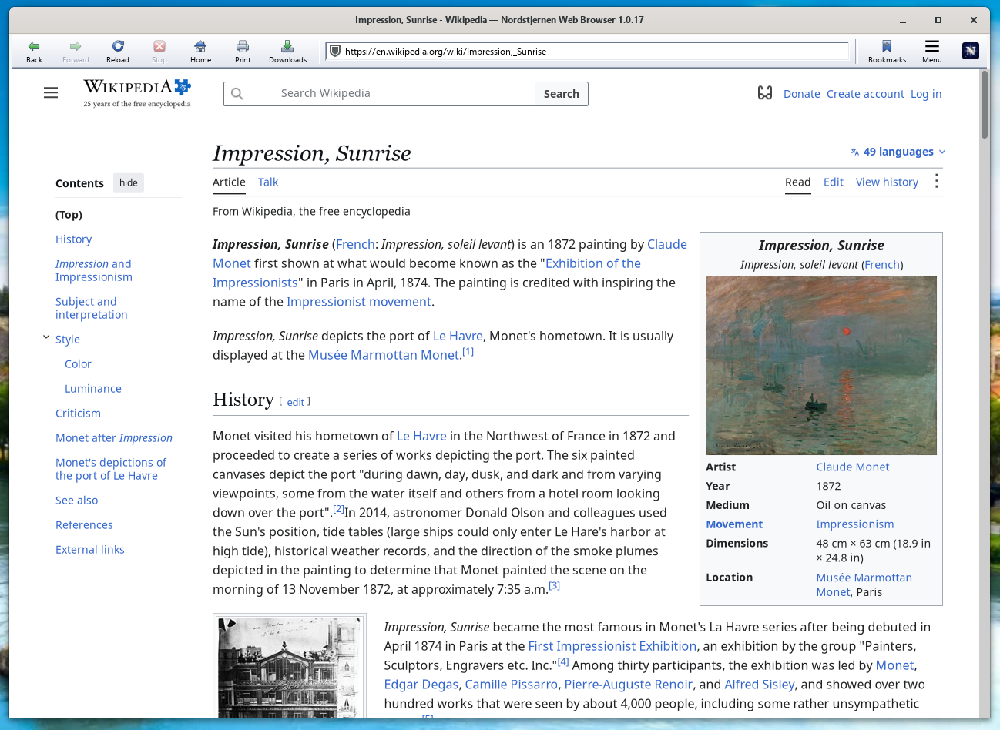

# Northstar Web Browser

Northstar Web Browser is a minimalist web browser written from scratch in C. Its
engine targets practical HTML5, modern CSS and JavaScript compatibility
without embedding Gecko, WebKit, Blink or another browser engine. Linux
is the primary platform; macOS and Windows are also supported.



Repository: <https://github.com/nordstjernen-web/northstar-web-browser>.  
Windows store: https://apps.microsoft.com/detail/9p39zb79jv0t  

**See [Nordstjernen Sol](https://github.com/nordstjernen-web/nordstjernen-sol-browser) also, which is
the most complete, fully featured web browser project we are making. Nordstjernen Sol has ready-made builds for Windows, macOS, Linux and Android.**

Northstar Web Browser is licensed under the GNU General Public License, version 3 or
later.

## Multiple browser variants
* This repo, [Northstar Web Browser](https://github.com/nordstjernen-web/northstar-web-browser), is a minimalist, simple and good web browser: one process, one page per window, GPL only. It is more about research into browser technology.
* [Nordstjernen Sol](https://github.com/nordstjernen-web/nordstjernen-sol-browser) is the Nordstjernen web browser, the most complete, fully featured web browser, with tabs in sandboxed renderer processes and builds for desktop and Android.
* [Southstar](https://github.com/nordstjernen-web/southstar-browser) is Nordstjernen Sol rewritten in Rust, with the Boa JavaScript engine.

We are doing web browser innovation, research and development, and part of this is
making multiple web browser variants to test and compare.


**Web standards:** Behaviour is measured against the specification text,
section by section, not against another browser. The engine runs
web-platform-tests through headless mode; see
[docs/compliance.md](docs/compliance.md) for the current per-area scores
and the known structural gaps.

**Security:** on Linux the browser runs behind a Landlock filesystem
sandbox (plus `PR_SET_NO_NEW_PRIVS`) and a default-deny seccomp syscall
filter, which also refuses executable memory, new namespaces and signals
to other processes, in both GUI and headless/tooling modes. On macOS a
sandbox profile confines writes, and on Windows the process runs with
mitigation policies. There is no JIT. Frames, workers and extensions are
held to their own origin and Content-Security-Policy. See
[SECURITY.md](SECURITY.md) for the exact per-mode posture and the known
gaps.

**Minimalism:** one page per window, one process. The GTK shell runs on
the main thread and the page engine on one dedicated thread with its own
main loop, so a slow page never freezes the window; the shell posts
requests to that thread and gets rendered frames back, all inside the
same process. The engine is a compact body of C — about 207,000 lines of
original C, excluding the vendored web-text-lib, WAMR, Wuffs and audio
decoders — small enough for one person to read and audit end-to-end. See
[docs/architecture.md](docs/architecture.md) for how it fits together.

## What this edition is

This edition strips Nordstjernen down to a tab-less, single-process
desktop browser, based on the
[Nordstjernen project](https://github.com/nordstjernen-web/nordstjernen-sol-browser).
It deliberately omits tabs, per-tab renderer processes, WebGL, WebGPU,
an embedded PDF viewer and AI-style web APIs. It does not send telemetry
or update pings.

Audio and video still play in-process (MP3, MP2, AAC, Ogg Opus/Vorbis;
MPEG-1, and AV1, VP9 and H.264 when their decoders are present). Images
decode in-tree (PNG/APNG, GIF, BMP, JPEG and WebP via Wuffs, AVIF
through libavif when available, and SVG in the engine).

## No AI policy

From October 2026, Northstar Web Browser is developed without AI. Contributions — code,
documentation, translations, issues and pull requests — must be written by
people, not generated by AI coding assistants, large language models or
similar tools. Pull requests that contain AI-generated content will not be
accepted. The repository carries no AI-assistant configuration (such as
`CLAUDE.md`, `AGENTS.md`, `.claude/` or `.agents/`), and none should be
added.

## Browser features

- **HTML** parsed to a DOM by lexbor; **CSS** by the engine's own
  cascade — flex, grid and subgrid, transforms, gradients, `@keyframes`,
  scroll snap, container queries, cascade layers, `:has()`, nesting,
  `@property`, and typed `calc()` math over lengths, angles, times and
  resolutions.
- **JavaScript** on the quickjs-ng interpreter (or Fabrice Bellard's
  original QuickJS) — DOM, Shadow DOM, Mutation/Intersection/Resize/
  Performance observers, `Intl`, Canvas 2D (`Path2D`, `ImageBitmap`,
  `DOMMatrix`, `OffscreenCanvas`), WebCrypto (`crypto.subtle` over
  OpenSSL).
- **Custom elements** — autonomous and customized built-in elements.
- **Workers** — dedicated workers with structured-clone messaging,
  message channels and broadcast channels.
- **Storage** — IndexedDB over SQLite, `localStorage`/`sessionStorage`
  and the Cache API (`caches`, request/response pairs per the Service
  Workers specification, kept in IndexedDB), each partitioned by
  origin.
- **Live connections** — WebSockets (with libcurl 8.11 or newer, or one
  built with WebSocket support) and server-sent events.
- **Navigation API** — `window.navigation` for single-page routing.
- **Service workers** — origin-scoped registration, persistence,
  controlled-page fetch interception and offline pages served from the
  Cache API.
- **WebExtensions** — installed local extensions with manifest content
  scripts, `storage.local` kept apart per extension, `i18n`,
  declarativeNetRequest rule sets, and packaged resources that pages can
  load only when the extension lists them in `web_accessible_resources`.
- **Networking** over HTTP/2 with libcurl — HTTP/3 through Alt-Svc when
  the linked libcurl provides it — HTTPS-first navigation, HSTS,
  optional DNS-over-HTTPS, CSP, subresource-integrity (SRI) checks for
  scripts, and cookies partitioned by site — one libcurl cookie store per
  site, shared by `document.cookie` and that site's network requests.
- **Safe browsing** — before a top-level navigation is fetched, its host
  is checked against a local SHA-256 blocklist. The check runs entirely
  on-device. The bundled list carries only test entries; a real list goes
  in `~/.config/northstar/safebrowsing.list` or is named by
  `NS_SAFEBROWSING_LIST`.
- **Media** — images (PNG/APNG, GIF, BMP, JPEG, WebP, optional AVIF,
  SVG); audio (`<audio>`) decodes and plays in the browser process,
  alongside a Web Audio graph.
  `<video>` plays MPEG-1 (`video/mpeg`) decoded in-tree by the same
  pl_mpeg that already handles MP2 audio, a program stream's MP2 track
  included, with no extra dependency or licence. Streaming sites play
  through Media Source Extensions: `MediaSource` and `SourceBuffer`
  demux fragmented MP4 and WebM, a decoder thread per video decodes AV1
  (libdav1d), VP9 (libvpx) or H.264 (OpenH264) a few frames ahead, and
  the sound decodes AAC-LC (in-tree) or Opus (libopus). A plain MP4 or
  WebM file in `<video src>` is fetched progressively with HTTP range
  requests and plays through the same path. Decoded pictures are kept
  only a few frames ahead of the playhead, and `controls` draws a
  play/pause button, seek bar, time and mute button.
- **Camera** — `getUserMedia` video capture through V4L2 on Linux, asked
  for per site; a frame shares the page's permission only when it is
  same-origin or delegated with `allow="camera"`.
- **Printing** — `Ctrl+P` lays the page out for paper and hands the sheets
  to the operating system's own print dialog through `GtkPrintOperation`:
  CUPS on Linux, the Win32 dialog on Windows, the Cocoa panel on macOS.
  `@media print` matches, `@page` sets the sheet size and margins, and
  `break-before` / `break-after` / `break-inside` decide where a sheet
  ends.
- **MathML** — a minimalist presentation-MathML renderer.
- **Spell checking** — optional, via the Enchant library.
- **WebAssembly** — the JavaScript API over WAMR's fast interpreter,
  vendored in-tree; no JIT and no ahead-of-time compilation.
- **One process, no tabs** — each window shows one page (*New Window*
  opens another in the same process), and the page engine runs on its own
  thread inside the shell process; there are no renderer processes. A
  watchdog restarts the browser, with its session, after a crash or hang.
- **UI** — bookmarks, history, downloads, find-in-page, zoom, full
  screen, printing, save as PDF or image, page source, developer tools
  with a JS console, settings, private browsing (`--private`), and a UI
  translated into 40 languages that follows the operating-system
  language.
- **Headless mode** — text, DOM, layout, PNG and PDF dumps, scripted
  input and web-platform-tests runs from the command line; see
  [docs/building.md](docs/building.md#headless-mode-scripting--testing).

## Install with npm

```sh
npm install -g northstar-browser
northstar https://nordstjernen.org
```

The package builds Northstar from the release source on Linux, macOS, the
BSDs and Windows (with MSYS2), and first names any build dependency that is
missing. See [npm/README.md](npm/README.md).

## Build and run

On Debian or Ubuntu, install the required development packages:

```sh
sudo apt install build-essential git pkg-config meson ninja-build cmake \
    libgtk-4-dev libcurl4-openssl-dev libssl-dev libuchardet-dev \
    libharfbuzz-dev libfribidi-dev libcairo2-dev libfontconfig-dev \
    libfreetype-dev libpsl-dev libsqlite3-dev libseccomp-dev libsdl2-dev \
    zlib1g-dev
meson setup builddir
meson compile -C builddir
./builddir/src/gtk/northstar
```

For macOS (Homebrew or MacPorts), other Linux distributions and Windows,
see [docs/building.md](docs/building.md). To build, run and debug from
Visual Studio Code, see [docs/vscode.md](docs/vscode.md).

The development helper configures the default build directory when
needed and runs the same compile command:

```sh
./scripts/dev.sh build
./scripts/dev.sh smoke
```

The smoke command renders deterministic local fixtures through the
headless engine and compares them with the checked-in baselines. A
single page can also be rendered directly:

```sh
./builddir/src/gtk/northstar --headless --dump=text about:start
```

Meson feature options include `-Davif=disabled`, `-Daudio=disabled`,
`-Dwasm=disabled`, `-Dav1=disabled`, `-Dvp9=disabled` and
`-Dh264=disabled` for smaller builds; only Cisco's prebuilt OpenH264
binaries carry Cisco's H.264 patent licence, so `-Dh264=disabled` drops
it where that matters. `-Djs_engine=quickjs` builds on
Fabrice Bellard's original QuickJS instead of the default quickjs-ng.

WAMR, Wuffs, pl_mpeg, minimp3 and web-text-lib are vendored in-tree.
lexbor and quickjs-ng are pinned upstream subprojects (see
`subprojects/*.wrap`) that `meson setup` fetches; see
[docs/building.md](docs/building.md#updating-a-pinned-dependency) for how
a pin is moved.

### The `open-internet-browser` command

`meson install` puts `open-internet-browser` beside `northstar` in the
binary directory, a symbolic link to it, so `open-internet-browser
https://nordstjernen.org` starts Northstar Web Browser. Nordstjernen Sol
and Southstar install commands of their own (`open-browser-nordstjernen`
and `internet-browser-southstar`), so the three browsers install side by
side. The `.deb` and `.rpm` packages register `open-internet-browser`
with `update-alternatives` instead of shipping the link. On Windows the installer
registers `open-internet-browser` as an App Paths alias (the Run dialog
and `start open-internet-browser` find it) and the MSIX package declares
it as an app execution alias.

## Dependencies

Northstar Web Browser's engine is written from scratch — it contains no forked
browser engine (no Gecko, WebKit, or Blink). It is the GPL edition of the
[Nordstjernen project](https://github.com/nordstjernen-web/nordstjernen-sol-browser).

**Pinned upstream meson subprojects** (`subprojects/*.wrap`), fetched by
`meson setup`:

| Component | Role |
|-----------|------|
| [lexbor](https://github.com/lexbor/lexbor) v3.0.1 (commit `7e278c0`) | HTML5 → DOM parser and the WHATWG URL module |
| [quickjs-ng](https://github.com/quickjs-ng/quickjs) 0.17.0+ (master `9b06171`) | JavaScript engine — no JIT |
| [QuickJS](https://github.com/bellard/quickjs) 2026-06-04 | The original JavaScript engine, used instead of quickjs-ng with `-Djs_engine=quickjs` |

lexbor (3.0 or newer) and quickjs-ng take a system copy instead when the
build finds one.

**Vendored in-tree** (built from the main tree, no submodules):

| Component | Role |
|-----------|------|
| [WAMR](https://github.com/bytecodealliance/wasm-micro-runtime) 2.4.5 (subset) | WebAssembly fast interpreter |
| [Wuffs](https://github.com/google/wuffs) v0.4 | Memory-safe image decoding — PNG/APNG, GIF, BMP, JPEG, WebP |
| [pl_mpeg](https://github.com/phoboslab/pl_mpeg) (MIT) | In-process MPEG-1 video and MP2 audio decode |
| [minimp3](https://github.com/lieff/minimp3) (CC0) | In-process MP3 audio decode |
| web-text-lib (`src/web-text-lib/`, LGPL 2.1+) | Text itemization, shaping and line breaking — Nordstjernen's Pango fork with a cross-layout shaping cache, shared with Nordstjernen Sol |

**Required system libraries:** GTK 4 (≥ 4.14; ≥ 4.22.1 on Windows),
GLib (≥ 2.80), Cairo (≥ 1.18), HarfBuzz (≥ 8.3), FriBidi (≥ 1.0.6), fontconfig
(≥ 2.15), FreeType, libcurl (≥ 8.5), OpenSSL (libcrypto), uchardet,
libpsl, SQLite and zlib — Ubuntu 24.04, Debian 13 and Fedora 40 meet
every floor; Ubuntu 22.04 and older cannot build it. The engine lays
text out through web-text-lib rather than the system Pango; GTK still
links the system Pango for its own widgets, and the two coexist because
every symbol in the fork is renamed. Linux builds also require libseccomp.
SDL2 provides audio output: it is picked up when present and required
with `-Daudio=enabled`.

**Optional** (auto-detected): libdav1d, libvpx and OpenH264 (AV1, VP9
and H.264 video), libopus (Opus audio in WebM and MP4), libavif (AVIF
images), opusfile / vorbisfile (in-process Ogg audio), Enchant
(spell-checking) and libthai (Thai line breaking).

## License

Northstar Web Browser is free software, licensed under the **GNU General Public
License, version 3 or later** — see [LICENSE](LICENSE).

Project home: <https://nordstjernen.org/northstar-browser/> · Copyright 2026 Andreas Røsdal.

## Builds
[](https://github.com/nordstjernen-web/northstar-web-browser/actions/workflows/linux.yml)
[](https://github.com/nordstjernen-web/northstar-web-browser/actions/workflows/linux-i386.yml)
[](https://github.com/nordstjernen-web/northstar-web-browser/actions/workflows/musl.yml)
[](https://github.com/nordstjernen-web/northstar-web-browser/actions/workflows/macos.yml)
[](https://github.com/nordstjernen-web/northstar-web-browser/actions/workflows/windows.yml)
